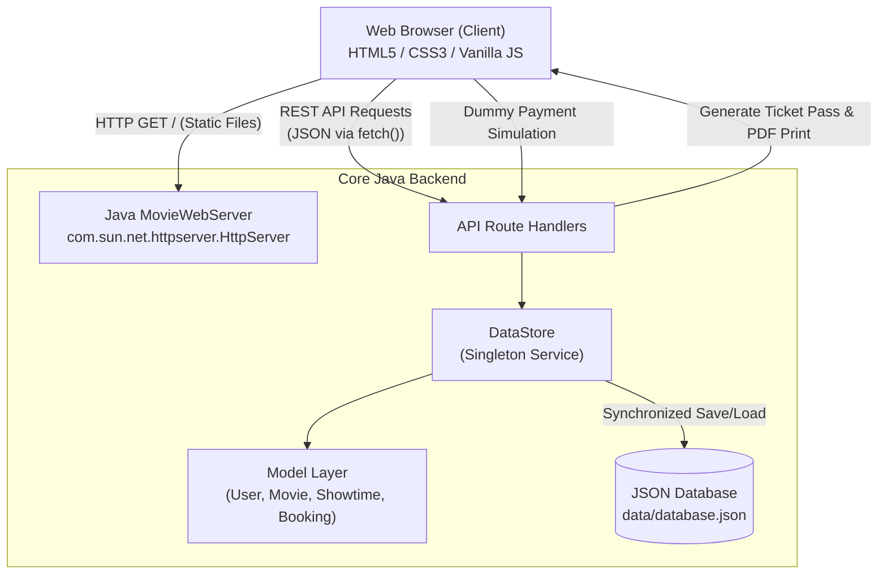

# 📘 CineShow - College Micro-Project Report & Viva Guide

> **Academic Level:** Second Year Diploma / Degree in Computer Engineering / Information Technology  
> **Course:** Advanced Java / Object Oriented Programming / Web Technology  
> **Project Title:** CineShow - Online Movie Ticket Booking System with Simulated Payment Gateway

---

## 1. Project Overview & Objectives

### 1.1 Problem Statement
Traditional box-office ticket purchasing causes long queues, lack of real-time seat transparency, and difficulty in managing seat availability across multiple theater screens.

### 1.2 Objectives
1. Provide a modern, responsive web application inspired by **BookMyShow** for browsing trending movies, showtimes, and theaters.
2. Enable user authentication (Sign In & Registration) so users can maintain a history of their booked tickets.
3. Offer an interactive theater screen and seat-selection matrix with distinct price categories (*Platinum Recliner, Gold Prime, Silver Classic*).
4. Implement a **realistic dummy payment gateway** supporting UPI (QR Scan), Credit/Debit Card, and Net Banking.
5. Provide persistent storage so booked tickets and registered users are preserved across server restarts.
6. Provide ticket cancellation functionality with automatic seat release.

---

## 2. System Architecture & Technical Flow

### 2.1 Why Pure Java without External Bulky Frameworks?
- **Zero Configuration Burden:** College laboratories frequently restrict installing external application servers like Apache Tomcat or configuring heavy Maven repositories.
- **Portability:** Java 17 includes the high-performance `com.sun.net.httpserver` module out-of-the-box.
- **Demonstrates Fundamental Mastery:** Creating the server and REST API from scratch using core Java libraries demonstrates genuine understanding of sockets, HTTP protocols, threading, and data structures.

---

## 3. Core Java Concepts Demonstrated (Viva Focus)

### 3.1 Object-Oriented Programming (OOP)
1. **Encapsulation:**
   - Classes `User`, `Movie`, `Showtime`, and `Booking` encapsulate private fields with getters, setters, and serialization methods (`toMap()`, `fromMap()`).
2. **Abstraction:**
   - `DataStore` abstracts away the underlying disk I/O and JSON parsing from the HTTP web handlers.
3. **Design Patterns:**
   - **Singleton Pattern:** `DataStore.getInstance()` ensures only one central data repository exists across all web threads.
   - **Model-View-Controller (MVC) / Separation of Concerns:**
     - *Model:* Java entities (`User`, `Movie`, `Showtime`, `Booking`).
     - *Controller:* HTTP Handlers (`MoviesHandler`, `BookingsHandler`, `LoginHandler`).
     - *View:* HTML5/CSS3/JavaScript frontend.

### 3.2 Multithreading & Race Condition Prevention
- **The Problem:** In a movie booking system, two users might click on the same seat (e.g., `C4`) simultaneously.
- **The Solution in Java:**
  - `Showtime.isAnySeatBooked()` and `Showtime.bookSeats()` use the `synchronized` keyword.
  - When User A is completing booking for seat `C4`, User B's request waiting on the same lock is rejected with a `409 Conflict / 400 Bad Request` ("One or more selected seats have already been booked!").
  - The HTTP server uses `Executors.newFixedThreadPool(10)` to serve concurrent requests across separate worker threads.

### 3.3 File I/O & Serialization
- All bookings, users, and updated seat states are serialized to `data/database.json` via Java standard `java.nio.file.Files` and `StandardCharsets.UTF_8`.
- If the server restarts, data is seamlessly reloaded.

---

## 4. Top 10 Viva Questions & Model Answers

### Q1: How is it possible to make a website in Java without using Spring Boot or Tomcat?
> **Answer:**  
> Java provides an embedded HTTP web server in the `com.sun.net.httpserver` package (`jdk.httpserver` module). We initialize `HttpServer.create()`, bind it to port `8080`, and register contexts (`server.createContext("/api/...", new Handler())`). The server responds with JSON data for API routes and serves HTML, CSS, and JS files for the frontend.

### Q2: How does the frontend communicate with the Java backend?
> **Answer:**  
> Communication happens via the standard **RESTful architectural style**. The frontend JavaScript uses modern `fetch()` API calls to send asynchronous HTTP requests (GET, POST) with JSON payloads (`Content-Type: application/json`). The Java backend parses the JSON, executes business logic, and returns JSON responses with HTTP status codes (200 OK, 201 Created, 400 Bad Request, 401 Unauthorized, 409 Conflict).

### Q3: How do you prevent double-booking of seats?
> **Answer:**  
> We use Java's `synchronized` methods inside `Showtime.java` and `DataStore.java`. When a booking request arrives, the server checks `showtime.isAnySeatBooked(seats)`. If any seat is already in the occupied set, the transaction is rejected immediately before committing.

### Q4: How is data preserved when the server stops?
> **Answer:**  
> We implemented a JSON file storage engine in `DataStore.java`. Whenever a user registers or books/cancels a ticket, the state is persisted to `data/database.json`. We also added a Java `Runtime.getRuntime().addShutdownHook()` to guarantee saving upon server termination.

### Q5: How does the Dummy Payment Gateway work?
> **Answer:**  
> The dummy payment gateway simulates real Indian payment checkouts (like Razorpay or PayTM). It validates user inputs (UPI ID, 16-digit card number, CVV, or bank selection) and runs a multi-step animation simulating bank authorization before confirming the booking and assigning a unique transaction ID (`TXN_XXXXX`). No real bank credentials or money are used.

### Q6: Can a user cancel their ticket and get their seats back?
> **Answer:**  
> Yes! In the "My Bookings" section, the user can click "Cancel Ticket". The backend updates the booking status to `CANCELLED` and calls `showtime.releaseSeats(seats)`, returning the seats to the available pool for other users to book.

### Q7: Why did you use `localStorage` on the frontend?
> **Answer:**  
> `localStorage` stores the authenticated user's session token/profile on the browser side so that when the user refreshes the page or navigates between views, they stay logged in.

### Q8: What data structure was used to store booked seats?
> **Answer:**  
> We used `LinkedHashSet<String>` because a `Set` offers $O(1)$ constant time lookups for checking if a seat is taken, prevents duplicate seat labels, and maintains insertion order.

### Q9: What happens if `data/database.json` is missing?
> **Answer:**  
> `DataStore.loadOrInit()` detects if the file does not exist. If missing, it automatically seeds initial movie records (*Jawan, Kalki, Inception, Stree 2, etc.*), theaters, showtimes, and a default demo user account (`demo@example.com` / `password123`).

### Q10: How does ticket printing work?
> **Answer:**  
> The web page includes a CSS `@media print` query that targets `#printableTicket`. When the user clicks "Print / Save Ticket", the browser triggers `window.print()`, hiding all navigation bars and background styling to render a clean black-and-white physical admission ticket or PDF pass.

---

## 5. Conclusion
CineShow successfully demonstrates a complete end-to-end web system using core Java concepts. It meets the requirements of a 2nd-year college micro-project by combining strong object-oriented backend programming, concurrency safety, clean file I/O, and an attractive BookMyShow-style user interface.

